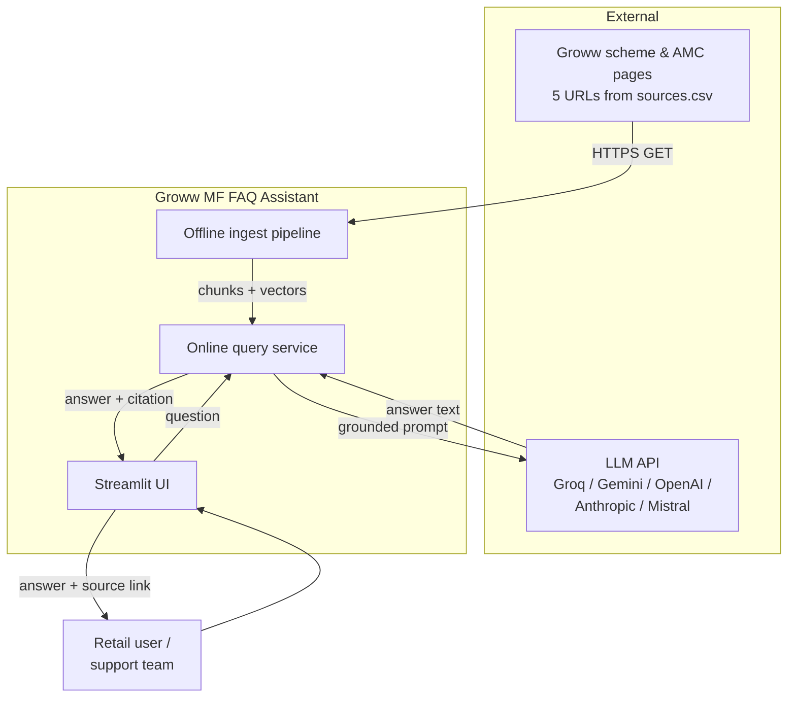
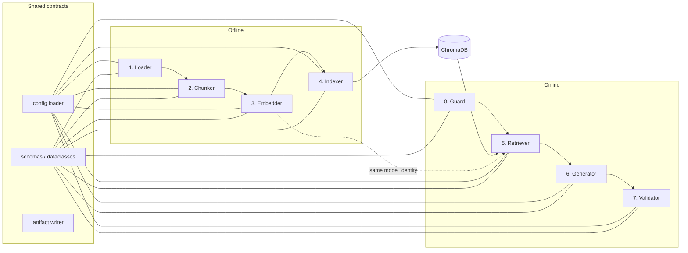
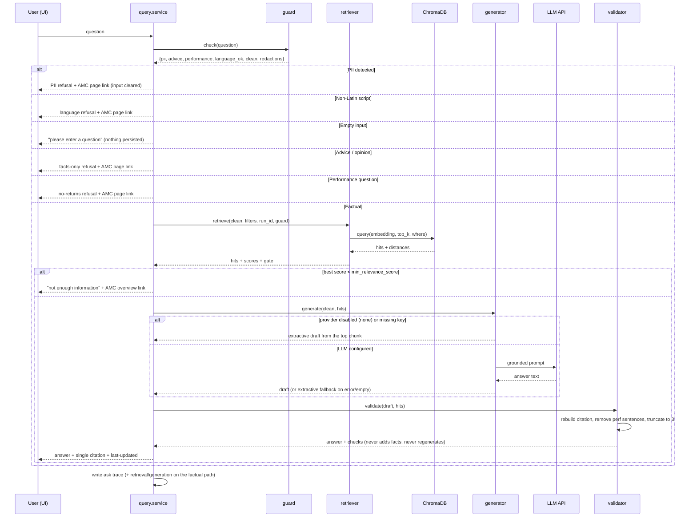
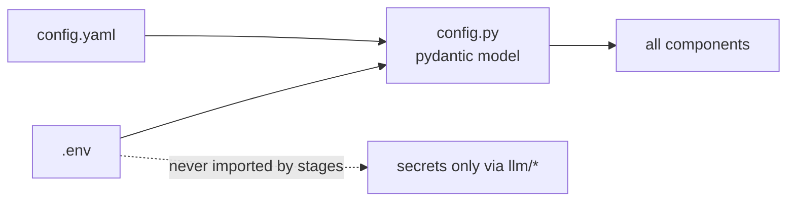
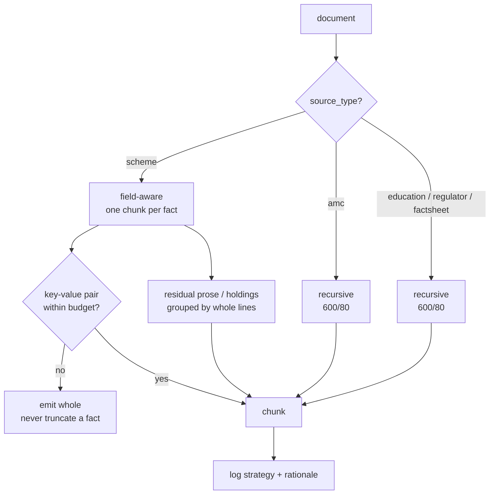

# Architecture — Groww Mutual Fund FAQ Assistant (RAG Prototype)

**Derived from:** `PRD.md` v1.0
**Version:** 1.0
**Status:** Draft for build
**Last updated:** 2026-11-01

---

## 1. Purpose of this document

`PRD.md` defines *what* is being built. This document defines *how* it is built: the components, the boundaries between them, the data contracts that flow across those boundaries, and the failure behaviour at each boundary.

Two properties drive every decision here:

1. **Stage inspectability** (PRD G5) — every RAG stage is a separate, re-runnable unit that persists its own artifact. Nothing is a black box.
2. **Swappability by configuration** (PRD §7) — embedding model, vector DB, and LLM provider are all replaceable without touching pipeline logic.

---

## 2. Architectural drivers

| Driver | Source | Architectural consequence |
|--------|--------|---------------------------|
| Two disjoint workloads: batch ingest vs. interactive query | PRD §8 | Split into an **offline pipeline** and an **online query service** with a shared contract layer |
| Every stage must be inspectable | PRD G5 | Stage functions are pure `input artifact → output artifact`; orchestration only wires them |
| Embedding model must match between ingest and query | PRD FR-3.5 | Embedding model identity is recorded in the index manifest and verified at query-service startup |
| One citation per answer, from retrieved metadata only | PRD FR-6.4 | Citation is *selected from metadata*, never generated by the LLM; LLM output is post-validated against the context |
| PII must never be stored | PRD FR-7.2 | Guard runs **before** retrieval, before logging, and before any LLM call |
| Small corpus (5 fixed pages) | PRD §5 | No need for distributed retrieval; local ChromaDB + in-process MiniLM is sufficient |
| Demo must run without API keys | PRD FR-6.8 | Extractive fallback path is a first-class mode, not an error handler |

---

## 3. System context



**Trust boundary:** only `ING` talks to the public web; only `QRY` talks to the LLM. The LLM never receives raw HTML, raw user input with PII, or any URL outside the retrieved metadata.

---

## 4. Container / component view



### 4.1 Component inventory

| # | Component | Responsibility | PRD refs |
|---|-----------|----------------|----------|
| 0 | **Guard** | PII detection/redaction; advice, performance & language classification | FR-7.1–7.6 |
| 1 | **Loader** | Fetch URLs, extract main content, normalize, hash, persist raw + processed docs | FR-1.1–1.6 |
| 2 | **Chunker** | Classify doc type, choose strategy, emit field-aware or recursive chunks | FR-2.1–2.7 |
| 3 | **Embedder** | Batch-embed chunks with MiniLM, cache by content hash, persist vectors | FR-3.1–3.5 |
| 4 | **Indexer** | Upsert into ChromaDB with metadata; rebuild support | FR-4.1–4.5 |
| 5 | **Retriever** | Embed query, top-k search, metadata filter, dedupe, relevance gate | FR-5.1–5.6 |
| 6 | **Generator** | Build grounded prompt, call configured LLM, extractive fallback | FR-6.1–6.8 |
| 7 | **Validator** | Enforce ≤3 sentences, single valid citation, no performance claims, disclaimer | FR-6.4, FR-7.6 |
| 8 | **UI** | Chat surface, example chips, citation rendering, pipeline expander | FR-8.1–8.5 |
| 9 | **Config** | Single source of tunables; `.env` for secrets | PRD §7 |
| 10 | **IO/run-id** | `pipeline/lib/io.py` + `runid.py`: uniform `run_id`-scoped JSON persistence | G5 |

---

## 5. Module layout

```
growwchatbott/
├── config.yaml
├── .env.example
├── requirements.txt
├── sources.csv
├── app.py                        # Streamlit entrypoint
├── PRD.md
├── architecture.md
├── data/
│   ├── raw/                      # <doc_id>.html + <doc_id>.txt
│   ├── processed/
│   │   ├── documents.jsonl
│   │   ├── chunks.jsonl
│   │   └── chunks_preview.md
│   ├── embeddings/
│   │   ├── embeddings.npy
│   │   ├── id_map.json
│   │   ├── chunk_hashes.json
│   │   └── manifest.json
│   └── chroma/                   # ChromaDB persistence
├── artifacts/
│   ├── retrieval/<run_id>.json
│   ├── generation/<run_id>.json
│   └── runs/
│       ├── load.json
│       ├── chunk.json
│       ├── embed.json
│       ├── index.json
│       └── <run_id>.json         # combined ask trace
├── pipeline/
│   ├── __init__.py
│   ├── run.py                    # CLI: --stage load|chunk|embed|index|all
│   ├── stages/
│   │   ├── loader.py
│   │   ├── chunker.py
│   │   ├── embedder.py
│   │   └── indexer.py
│   └── lib/
│       ├── config.py
│       ├── schemas.py
│       ├── io.py
│       ├── runid.py
│       ├── http.py
│       ├── documents.py
│       └── fields.py
├── query/
│   ├── service.py                # ask(question) -> Answer
│   ├── guard.py
│   ├── retriever.py
│   ├── generator.py
│   ├── validator.py
│   └── prompts.py
├── llm/
│   ├── base.py                   # LLMProvider protocol + factory
│   └── providers/
│       ├── none_.py              # deliberate extractive mode
│       └── groq_.py
└── tests/
    ├── fixtures/
    ├── test_documents.py
    ├── test_chunker.py
    ├── test_embedder.py
    ├── test_indexer.py
    ├── test_retriever.py
    ├── test_guard.py
    ├── test_validator.py
    ├── test_generator.py
    ├── test_llm.py
    ├── test_service.py
    ├── test_e2e.py
    └── test_app.py
```

**Rule:** `pipeline/stages/*` must not import from `query/*` and vice versa. Both may import `pipeline/lib/*` and `llm/base.py`. This keeps the offline and online halves independently testable and prevents the LLM layer leaking into ingestion.

---

## 6. Data contracts

All artifacts are JSONL/JSON so each stage can be inspected, diffed, and replayed. Contracts are defined once in `pipeline/lib/schemas.py` and used by both halves.

### 6.1 `sources.csv`

```csv
id,url,title,source_type,scheme_name,question_types
s01,https://groww.in/mutual-funds/amc/hdfc-mutual-funds,HDFC Mutual Fund,amc,,amc_overview
s02,https://groww.in/mutual-funds/hdfc-large-cap-fund-direct-growth,HDFC Large Cap Fund,scheme,HDFC Large Cap Fund,expense_ratio|exit_load|min_sip|riskometer|benchmark
s03,https://groww.in/mutual-funds/hdfc-equity-fund-direct-growth,HDFC Flexi Cap Fund,scheme,HDFC Flexi Cap Fund,expense_ratio|exit_load|min_sip|riskometer|benchmark
s04,https://groww.in/mutual-funds/hdfc-elss-tax-saver-fund-direct-plan-growth,HDFC ELSS Tax Saver,scheme,HDFC ELSS Tax Saver Fund,expense_ratio|exit_load|min_sip|lock_in|riskometer|benchmark
s05,https://groww.in/mutual-funds/hdfc-mid-cap-fund-direct-growth,HDFC Mid Cap Fund,scheme,HDFC Mid Cap Fund,expense_ratio|exit_load|min_sip|riskometer|benchmark
```

`source_type` ∈ `{scheme, amc, education, regulator, factsheet}`. `question_types` is a `|`-separated tag list used for coverage checks at build time.

### 6.2 `data/processed/documents.jsonl`

```json
{
  "doc_id": "s03",
  "url": "https://groww.in/mutual-funds/hdfc-equity-fund-direct-growth",
  "title": "HDFC Flexi Cap Direct Plan Growth",
  "source_type": "scheme",
  "scheme_name": "HDFC Flexi Cap Fund",
  "fetched_at": "2026-11-01T09:12:44Z",
  "content_hash": "sha256:9f2c…",
  "text": "Expense ratio\n0.75% …"
}
```

### 6.3 `data/processed/chunks.jsonl`

```json
{
  "chunk_id": "s03:f_expense_ratio:0",
  "doc_id": "s03",
  "url": "https://groww.in/mutual-funds/hdfc-equity-fund-direct-growth",
  "title": "HDFC Flexi Cap Direct Plan Growth",
  "scheme_name": "HDFC Flexi Cap Fund",
  "field": "expense_ratio",
  "source_type": "scheme",
  "strategy": "field_aware",
  "text": "HDFC Flexi Cap Fund — Expense ratio: 0.75%",
  "position": 0,
  "fetched_at": "2026-11-01T09:12:44Z"
}
```

`field` is drawn from a closed vocabulary: `expense_ratio`, `exit_load`, `min_sip`, `min_investment`, `lock_in`, `riskometer`, `benchmark`, `fund_manager`, `aum`, `scheme_count`, `definition`, `general`. A closed vocabulary is what makes metadata filtering and dedupe reliable (FR-5.3, FR-5.4). `definition` is a glossary entry (e.g. *what is exit load?*), kept separate from the scheme's actual `exit_load` value; `scheme_count` is the AMC's "No of Schemes" label.

### 6.4 `data/embeddings/manifest.json`

```json
{
  "schema_version": 1,
  "model": "sentence-transformers/all-MiniLM-L6-v2",
  "dimension": 384,
  "normalize": true,
  "chunk_count": 170,
  "built_at": "2026-11-01T09:20:10Z",
  "chunks_hash": "sha256:41ab…",
  "collection": "groww_mf_faq"
}
```

`chunks_hash` hashes the whole `chunks.jsonl` file; `chunk_hashes.json` stores a per-chunk `sha256(text)` so the embedder can reuse individual rows when one page changes. `built_at` only moves when a vector was actually encoded, which keeps no-op rebuilds byte-identical.

**Startup check (FR-3.5):** `query/service.py` compares `config.embedding.model` against `manifest.model` and `config.vector_db.collection` against `manifest.collection`. Mismatch → hard fail with a message telling the operator to re-run the ingest pipeline.

### 6.5 ChromaDB record

| Element | Value |
|---------|-------|
| `id` | `chunk_id` |
| `embedding` | 384-dim float32 |
| `document` | `chunk.text` |
| `metadata` | `url`, `title`, `scheme_name`, `field`, `source_type`, `fetched_at`, `doc_id` |

All metadata values are scalar (Chroma constraint); no nested dicts.

### 6.6 Query artifacts

`artifacts/retrieval/<run_id>.json`:

```json
{
  "run_id": "20261101T093301Z-7f3a",
  "question": "What is the exit load for HDFC ELSS?",
  "guard": { "pii": false, "advice": false, "performance": false,
             "language_ok": true, "truncated": false, "redactions": [] },
  "query_embedding_model": "sentence-transformers/all-MiniLM-L6-v2",
  "collection": "groww_mf_faq",
  "distance": "cosine",
  "filters": { "scheme_name": "HDFC ELSS Tax Saver Fund" },
  "top_k": 5,
  "n_results": 5,
  "dedupe_by_field": true,
  "min_relevance_score": 0.35,
  "best_score": 0.375,
  "hits": [
    { "chunk_id": "s04:f_exit_load:0", "score": 0.81, "field": "exit_load",
      "url": "https://groww.in/…/hdfc-elss-…", "text": "Exit load: Nil after 1 year…" }
  ],
  "relevance_gate": "pass"
}
```

Every query leaves its own retrieval artifact, so the gate decision, the filter that narrowed the search, and the scores of all candidates can be inspected after the fact. `question` is the redacted form only.

`artifacts/generation/<run_id>.json`:

```json
{
  "stage": "generate",
  "run_id": "20261101T093301Z-7f3a",
  "provider": "groq",
  "model": "qwen/qwen3.8-27b",
  "temperature": 0.0,
  "prompt": "<full system + user prompt>",
  "raw_response": "<verbatim model output>",
  "mode": "llm",
  "fallback_reason": "",
  "error": "",
  "latency_ms": 1840,
  "validation": { "sentences": 2, "citation": "https://groww.in/...",
                  "citation_valid": true, "citation_replaced": false,
                  "perf_claims": false, "perf_removed": 0, "fallback_used": false }
}
```

The generation artifact is written **after** validation, so `prompt`, `raw_response`, and `validation` live in one file. A refusal (guard or gate) writes no generation artifact at all, which is why `runs/<run_id>.json` carries `generation_trace: null` for those modes.

---

## 7. Query lifecycle



### 7.1 Guard ordering (critical)

```
raw question
   │
   ├─► truncate to max_input_chars (500)
   │
   ├─► PII scan ──► hit ──► redact → refuse → STOP (no retrieval, no LLM, no raw text persisted)
   │
   ├─► language check ──► non-Latin ──► refuse + AMC page link → STOP
   │
   ├─► empty check ──► nothing to answer ──► prompt, nothing persisted → STOP
   │
   ├─► advice/opinion classify ──► hit ──► refuse + AMC page link → STOP
   │
   ├─► performance classify ──► hit ──► refuse + AMC page link → STOP
   │
   └─► factual ──► retrieval → generation → validation
```

The PII scan runs **before** any logging of the question. Only the redacted form (`"my PAN is [REDACTED_PAN]"`) may be written to artifacts (FR-7.5). The classifier runs on the redacted text so a redaction marker cannot match an advice rule. When more than one rule fires, the service priority is `pii → language → empty → advice → performance`.

### 7.2 Citation selection

The LLM is instructed to emit `Source: <URL>`, but the URL is treated as untrusted output. `validator.py`:

1. Extracts the URL from the draft.
2. Asserts it appears in the retrieved hit metadata.
3. If absent, **replaces** it with the highest-scoring hit's `url` — the citation is ultimately a *metadata selection*, not a generation (PRD FR-6.4).

This guarantees 100% citation validity (PRD §14) regardless of model behaviour. The date line is taken from the **cited** hit, not necessarily the top hit, so a two-scheme answer still carries the right date.

### 7.3 Sentence enforcement

`max_answer_sentences: 3` is enforced structurally: the validator splits on sentence boundaries and keeps the first 3. Before that, performance sentences are **removed**, not merely flagged (`perf_removed` counts them); if filtering empties the draft, the validator falls back to the top chunk only when that chunk is also free of performance words. There is **no regeneration loop** — the validator can only remove content, never add facts, and a retry would add latency plus another chance for a fabricated URL.

---

## 8. Configuration and secrets flow



- `config.yaml` holds every non-secret tunable (PRD §7).
- `.env` holds `LLM_PROVIDER`, `LLM_MODEL`, and API keys only.
- `config.py` validates on load: unknown keys → error (catches typos silently disabling features); out-of-range `top_k`/`chunk_size` → error.
- Precedence: `.env` overrides `config.yaml` for the keys it defines; secrets never have a `config.yaml` default.
- `config.yaml` is committed; `.env` is git-ignored, `.env.example` is committed.

### 8.1 Provider abstraction

```python
# llm/base.py
class LLMProvider(Protocol):
    name: str
    def complete(self, system: str, user: str, *, temperature: float,
                 max_tokens: int, timeout: int) -> str: ...

def get_provider(cfg) -> LLMProvider:   # factory keyed on cfg.llm.provider
    ...
```

Adding a provider = one file in `llm/providers/` + one factory line. No pipeline or query code changes (PRD FR-6.1, acceptance criterion "LLM provider swapped by editing `.env` only").

### 8.2 Embedding / vector DB abstraction

The shipped implementations are concrete but resolved from config:

| Concern | Config key | Implementation | Swap path |
|---|---|---|---|
| Embedding | `embedding.model`, `batch_size`, `normalize`, `cache_dir` | `pipeline/stages/embedder.py` loads `SentenceTransformer(cfg.embedding.model)` | change the model id; `manifest.json` records it, so a different model forces a full re-encode |
| Vector store | `vector_db.provider`, `persist_dir`, `collection`, `distance` | `pipeline/stages/indexer.py` + `query/retriever.py` use `chromadb.PersistentClient` | the indexer refuses any provider other than `chromadb`; adding one means implementing the same `upsert`/`query`/`count` surface |
| LLM | `llm.provider`, `llm.model` | `llm/base.py` factory + `llm/providers/{groq_,none_}.py` | one adapter file + one factory line (the only place that uses a formal `Protocol`) |

Only the LLM layer has a runtime `Protocol`, because that is the boundary with the most churn. The embedding and vector-store boundaries are enforced by the manifest contract instead: a mismatched model, normalization, dimension, collection, or distance fails at startup rather than silently mixing spaces.

---

## 9. Ingestion pipeline design

### 9.1 Stage contract

Every stage obeys the same shape:

```python
def run(cfg: Config, *, force: bool = False) -> StageReport:
    """Read previous stage's artifact → write own artifact → return report."""
```

`StageReport` carries counts (`read`, `written`, `skipped`, `failed`), duration, and warnings. Each stage writes its own artifact (`artifacts/runs/{load,chunk,embed,index}.json`) and `pipeline/run.py` writes `artifacts/runs/last_run.json` summarizing the command, so one invocation leaves a complete, inspectable ingest trail.

### 9.2 Loader

| Aspect | Decision |
|--------|----------|
| HTTP | `httpx` with configured UA, 2s delay, 3 retries w/ exponential backoff, 20s timeout |
| Extraction | `div.layout-main` (Groww's content wrapper) → `<main>` → `[role=main]` → body minus `nav`/`footer`/`aside`; tables preserved as header-aware `key: value` lines |
| Scope | Only the URLs in `sources.csv` are fetched — one request each. No link following, no sitemaps, no crawl queue |
| Idempotency | `content_hash` compared against prior `documents.jsonl`; unchanged → skip (FR-1.5) |
| Failure | Non-200 or empty extraction → record in `extract_warnings`, keep prior doc, never emit an empty document |
| Politeness | `robots.txt` checked once per host, cached |

### 9.3 Chunker — strategy selection



Field-aware extraction uses a label map (`"Expense ratio"` → `expense_ratio`, `"Exit load"` → `exit_load`, …). It handles three things the raw page text contains:

- **Glossary vs value.** Groww shows `Exit load` twice: a long definition, then the real value (`Nil`). A value that is a sentence (≥70 chars, ≥10 words, ends with `.`) becomes a `definition` chunk; a short value becomes the fact. Ties between duplicate labels go to the last occurrence, and `Fund size (AUM)` outranks the AMC-level `Total AUM` on scheme pages.
- **Header facts.** The riskometer (`Very High Risk`) and the ELSS lock-in (`3Y Lock-in`) are not label/value pairs; they are read from the scheme header.
- **Residual prose.** Every recognised pair is removed from the leftover text (so an unselected `Total AUM` cannot contradict the chosen fact), and the remainder is grouped into `general` chunks. The Groww-generated `About` block is skipped because it repeats the AMC-level AUM on every scheme page.

**Invariant (FR-2.4):** a `key: value` pair is never split across chunks; if a fact exceeds `chunk_size`, it is emitted whole rather than truncated — facts are small and correctness beats uniformity. `general` chunks are grouped by whole lines (never mid-line), with overlap measured in whole lines.

Rationale logging is required because the PRD allows an agent to choose the strategy; the demo must be able to show *why* a strategy was chosen, not just which.

### 9.4 Embedder and indexer

- Embeddings keyed by `(chunk_id, sha256(chunk.text))`; the model identity lives in `manifest.json`, so unchanged chunks reuse cached vectors and a model change forces a full re-encode (FR-3.3).
- `--rebuild` on the indexer drops and recreates the collection; incremental mode upserts by `chunk_id`, so a changed page replaces its old chunks.
- Deleted-chunk handling: `indexer` computes `prior_ids − current_ids` and deletes them, otherwise stale facts survive a page edit.
- Before writing, the indexer verifies `manifest.model`, `normalize`, `dimension`, and `chunks_hash` against the current config and `chunks.jsonl`; a mismatch fails with the command to re-run. An existing collection with a different `hnsw:space` must be rebuilt instead of silently switching similarity.

---

## 10. Safety architecture

| Layer | Mechanism | Failure mode if absent |
|-------|-----------|------------------------|
| Pre-retrieval PII | Regex over the raw text first, then substitution with `[REDACTED_<LABEL>]` | PII reaches logs and LLM |
| Pre-retrieval advice | Rule classifier (imperative buy/sell/hold, "should I", "best", "compare", "risky", "is this safe") | Assistant gives advice |
| Pre-retrieval performance | Rule classifier (returns, CAGR, performance, profit, gains, "how much will I earn") | Assistant computes a return figure |
| Pre-retrieval language | Non-Latin script rejection | The English corpus silently mis-answers |
| Prompt-level | System prompt forbids advice/returns/outside knowledge | Model drifts |
| Post-generation | Validator: citation ∈ context, ≤3 sentences, perf sentences removed (`\d+(\.\d+)?\s*%\s*(p\.?a\.?|annual|return|cagr)` plus performance words) | Fabricated facts or returns slip through |
| Logging | Redaction before any persistence | Compliance breach |

**Defence in depth, but ordered:** guards are cheap and deterministic, so they run first and short-circuit. The validator is the last line and can only ever *remove* content, never add.

### 10.1 Advice classifier scope

Advice rules cover: `should i`, `is it good`, `best`, `worth it`, `recommend`, `compare`, `will it give`, `buy`, `sell`, `hold`, `invest in`, `portfolio`, `is this/it risky`, `is this/it safe`. A hit → refusal. A separate performance rule set covers `returns`, `cagr`, `performance`, `profit`, `gains`, and `how much will/would/could/has/did/can`, because a performance question contains no `%` but still asks for a figure the corpus must not compute. A language rule rejects any non-Latin script; Latin-script English and Hinglish pass. Ambiguous phrasing falls through to retrieval; if retrieval's best score is low, the relevance gate returns the "not enough information" response rather than a guess.

The rules are deliberately conservative: `"How do I download my capital gains statement?"` trips the `gains` rule and is refused even though it is procedural. Over-refusing a factual question is safer than letting a return figure through.

---

## 11. Error handling and degradation

| Failure | Behaviour |
|---------|-----------|
| Source page unreachable at ingest | Keep prior document; warn; report non-zero exit if any *primary* source is missing |
| Empty extraction | Warn; exclude document; coverage check flags the affected question type |
| Embedding model missing locally | Clear error with `pip install` hint; no partial index written |
| Config/manifest model mismatch | Hard fail at startup with remediation command |
| Chroma collection empty / manifest missing | UI shows "The index is not ready. Run `python -m pipeline.run --stage all` and reload this page." |
| LLM timeout / 429 / 5xx | No retry: immediate **extractive fallback** returns the top hit's text verbatim + its URL, recorded as `mode=extractive_fallback`, `fallback_reason=provider_error` |
| LLM returns invalid citation | Replace with the cited hit's URL; log `citation_replaced: true` |
| LLM returns >3 sentences | Truncate to 3, preserving citation line |
| LLM emits a performance sentence | Sentence is removed, `perf_removed` counts it; empty result falls back to a performance-free chunk |
| No API key configured | `get_provider()` returns `NoneProvider(reason="GROQ_API_KEY is not set")`; the answer is extractive, `mode=extractive`. No separate mode switch or UI badge is needed |

The extractive fallback is the reason the demo is never dead: retrieval is the load-bearing part; the LLM is an eloquence layer.

---

## 12. Observability and inspectability

| Artifact | Written by | Purpose |
|----------|------------|---------|
| `documents.jsonl` | Loader | Show raw→clean text transformation |
| `chunks_preview.md` | Chunker | Human-readable chunk inspection |
| `artifacts/runs/chunk.json` | Chunker | Strategy + field/general counts per doc, selected facts |
| `embeddings.npy` / `manifest.json` | Embedder | Show vectors + model identity |
| `artifacts/runs/embed.json` | Embedder | Encoded/reused counts, cache hit, artifact paths |
| `artifacts/runs/index.json` | Indexer | Collection count, upsert/delete counts, distance, rebuild flag |
| `data/chroma/` | Indexer | Live store, inspectable via Chroma client |
| `artifacts/retrieval/<run_id>.json` | Retriever | Redacted question, filters, every hit + score, best score, gate outcome |
| `artifacts/generation/<run_id>.json` | Generator | Provider/model, full prompt + raw response, mode, fallback reason, validation |
| `artifacts/runs/<run_id>.json` | `query.service` | Combined ask trace: guard verdict, hits, draft, final answer, links to the two traces above |

The UI's **"Show pipeline"** expander renders a single answer's chain in place: guard verdict → hits with scores → validation checks → prompt → provider/model → latency, plus the path to `artifacts/runs/<run_id>.json`. There is no separate `pipeline.inspect` command; the artifacts above are the inspection surface, and they are plain JSON.

Logging: structured JSON to stdout; `run_id` on every line; question text is the **redacted** form only.

---

## 13. Non-functional design

| Property | Approach |
|----------|----------|
| **Determinism** | `temperature: 0.0`; deterministic chunker (stable ordering by `doc_id`, `position`); embeddings cached by content hash |
| **Idempotency** | Every ingest stage compares hashes and skips unchanged work; re-running `--stage all` twice yields identical artifacts |
| **Latency** | Query budget <5s with LLM, <1s extractive. MiniLM runs in-process (no network hop); Chroma is local; only the LLM call is remote |
| **Cost** | 170 chunks for 5 pages → negligible embedding cost; one LLM call per factual query (zero in extractive mode) |
| **Portability** | Pure Python; no Docker requirement; runs on a laptop with `pip install -r requirements.txt` |
| **Security** | No auth (single-user demo); secrets only from `.env`; no PII persistence; outbound calls restricted to the source allowlist + configured LLM host |
| **Data freshness** | `fetched_at` surfaced in every answer; manual refresh command only (no scheduler in scope) |

---

## 14. Testing strategy

| Level | Test | Asserts |
|-------|------|---------|
| Unit | `tests/test_documents.py` | `load_documents()` validates the saved `documents.jsonl` without network; empty `scheme_name` allowed only for non-scheme docs |
| Unit | `tests/test_chunker.py` | No key-value split; closed `field` vocabulary; strategy logged; field-aware dedupe; residual excludes AUM/About |
| Unit | `tests/test_embedder.py` | Per-chunk cache hit/miss; model change invalidates; `--force` bypass; `built_at` only moves when vectors are encoded |
| Unit | `tests/test_indexer.py` | Manifest/model/dimension/`chunks_hash` checks; distance mismatch refused; stale ids deleted; batch upsert; collection rename reuses vectors |
| Integration | `tests/test_retriever.py` | Real Chroma in `tmp_path`, faked embeddings: `where` filter, distance→similarity, `n_results` cap, dedupe, gate, trace path |
| Unit | `tests/test_guard.py` | Every PII label redacted and absent from `to_json()`; advice/performance sets; truncation; non-Latin rejection; Hinglish acceptance |
| Unit | `tests/test_validator.py` | >3 sentences truncated; foreign URL replaced; perf sentences removed; date from the cited hit; contract lines stay out of the body |
| Unit | `tests/test_generator.py` / `test_llm.py` | Prompt grounding; extractive and fallback modes; missing key → `NoneProvider`, not a crash |
| Integration | `tests/test_service.py` | Guard-before-retrieval; PII never persisted; refusal links; gate failure; three linked artifacts |
| Integration | `tests/test_e2e.py` | Real corpus + real MiniLM/Chroma, keyless: PRD questions return the expected URL fragment; weather → AMC link; PII absent from every artifact |
| UI | `tests/test_app.py` | `AppTest` render, chip click, form submit, PII clearing, index error, selector prefill, expander prompt/model/latency |
| Contract | Manifest/model match | Startup fails on mismatch |

Tests run offline except `tests/test_e2e.py`, which reads the already-built local Chroma index and the cached MiniLM model — no Groww or LLM network call is made. Full suite: 183 tests, ~35 s on the reference machine.

---

## 15. Deployment and run modes

```bash
# one-time / refresh
pip install -r requirements.txt
python -m pipeline.run --stage all            # load → chunk → embed → index
python -m pipeline.run --stage all --rebuild  # full reindex

# interactive
streamlit run app.py                          # LLM mode (needs .env)
LLM_PROVIDER=none streamlit run app.py        # extractive mode

# test
pytest -q
```

**Topology:** single process, local files. No queue, no scheduler, no database server. Deliberate — the corpus is 5 pages and the deliverable is a demo. Query-time inspection is the UI's "Show pipeline" expander plus the JSON artifacts it points to; there is no separate inspector binary to maintain.

---

## 16. Key decisions (ADR summary)

| # | Decision | Rationale | Alternative rejected |
|---|----------|-----------|----------------------|
| D1 | Field-aware chunking for scheme pages | Maps 1 question → 1 fact; fixes MiniLM's weakness on tables | Uniform 600-token chunks (splits facts) |
| D2 | Citation selected from metadata, not generated | Guarantees 100% valid links | Trusting model output + retry loop |
| D3 | Extractive fallback as a first-class mode | Demo works keyless; retrieval is the real value | Fail with an error banner |
| D4 | Guards before retrieval | Cheap, deterministic, prevents PII ever reaching storage | Post-hoc filtering of logs |
| D5 | JSONL artifacts between stages | Inspectable, diffable, replayable | Pickled intermediate state |
| D6 | Provider factory for the LLM; config-driven embedding/store | Config-only swaps where it matters; fakes keep tests fast | Direct SDK calls scattered through pipeline code |
| D7 | Closed `field` vocabulary | Reliable metadata filter + dedupe | Free-text field labels |

---

## 17. Traceability to PRD

| PRD requirement | Architectural location |
|-----------------|------------------------|
| FR-1.x Loader | §4.1, §9.2 |
| FR-2.x Chunker | §9.3 |
| FR-3.x Embedder | §6.4, §9.4 |
| FR-4.x Indexer | §6.5, §9.4 |
| FR-5.x Retriever | §7, §7.1 |
| FR-6.x Generator | §7.2, §7.3, §8.1, §11 |
| FR-7.x Safety | §7.1, §10 |
| FR-8.x UI | §6.4 (implementation.md), §12 |
| G5 Inspectability | §12 |
| §7 Config | §8 |
| §11 Acceptance | §14, §15 |

---

## 18. Open architectural questions

1. **Retrieval scoring** — resolved: the retriever converts cosine distance to similarity once (`score = 1 − distance`, clamped to `[−1, 1]`), and the gate compares the best surviving hit with `min_relevance_score`. Collections must use cosine; an L2 collection is refused with a `--stage index --rebuild` instruction rather than scored with the wrong formula.
2. **Scheme inference** — resolved for the demo: an unnamed-scheme question searches the whole corpus. If the best hit clears `min_relevance_score`, it is answered from that chunk (often the generic `definition`, or an arbitrary scheme's value such as `"minimum SIP?"`); if the gate fails, the AMC overview link is used. There is no clarifying question. The sidebar selector pre-fills a canonical scheme name for users who want a scheme-specific fact.
3. **Chunker agent** — is the "AI chunking agent" a real LLM call or a deterministic rule table? Current design is a rule table with logged rationale; an LLM chooser would add latency and nondeterminism to a stage that benefits from neither.
4. **Statement how-to** — resolved: out of scope. No Groww help or HDFC MF pages are scraped, so the question is refused with the AMC page link and the `statement_howto` field stays unused.
5. **Multi-page facts** — if a fact appears on both the scheme page and a factsheet, which source wins? Proposal: scheme page first, factsheet as fallback, both retained as separate chunks with `source_type` in metadata.
